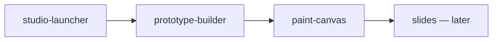
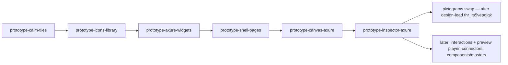

# Office Studio

> [!NOTE]
> Owner request (2026-10-17): an Office Viewer icon on the right of the thread header (next to Git History)
> opens a tools tab: a prototype builder (Axure analog: canvas, ready UI elements with name badges),
> Paint (brush drawing) and PowerPoint-like slides. A result is saved in the chat's files and goes
> to the chat as a screenshot and/or a file the agent can read.

## Decisions

| Question | Decision | Why |
| --- | --- | --- |
| Engine for prototypes | Own DOM canvas, elements are real shadcn-style components | No license risk (tldraw is paid, Excalidraw JSON is low-level rectangles); agent reads semantic JSON |
| Placement | Free positioning (Axure style), snap grid 8px | Owner described a canvas |
| Vocabulary | A2UI type names (Button, TextField, ChoicePicker, Checkbox, Card, Image, Table, Modal, Header, Nav, Text, Icon…) | Agents know them |
| File format | `*.wireframe.json`, zod-validated, version 1 | Agent-readable |
| Storage | thread storage `<storageRoot>/Prototypes/` (`bb.sdk.threads.storageLocation` + `bb.sdk.files.write`) | Native per-chat files; agent sees `$BB_THREAD_STORAGE` |
| To chat | `composer.experimental_vkAttachFiles([png, json])`; fallback absolute paths in composer text | Same path as image editor |
| Paint | Extend `src/media/image-editor.tsx`: blank canvas, eraser, palette, perfect-freehand | Research 4.2 |
| Slides | Phase 2, on the prototype engine | Lower priority |

## Tasks

- [x] `studio-launcher`: header icon + panel tab «Office Studio» with tool cards
- [x] `prototype-builder`: canvas, palette, badges, save/open/export/send
- [x] `paint-canvas`: blank-canvas paint mode, save and send
- [x] `prototype-inline-edit`, `prototype-palette-previews`, and `prototype-toolbar`: inline editing, visual palette tiles, and grouped icon controls
- [ ] slides (phase 2), components/states (Axure masters, dynamic panels) v2
- [x] release 0.8.8
- [x] release 0.8.9 (prototype palette, inline editing, and toolbar improvements)
- [x] release 0.8.10 (Axure parity batch renumbered to stay within the installed `^0.8` range)
- [ ] Studio live check

### Accepted work
- `lprun_38203a8bf69c43f294a012b07bded797`: `studio-launcher`, `studio-launcher-design`, `prototype-builder`, and `paint-canvas` accepted; Slides and the Studio release/live check remain open.
- `lprun_38203a8bf69c43f294a012b07bded797`: `prototype-inline-edit`, `prototype-palette-previews`, and `prototype-toolbar` accepted; release 0.8.8 shipped. Slides and the Studio live check remain open.
- `lprun_38203a8bf69c43f294a012b07bded797`: release 0.8.9 accepted; Slides and the Studio live check remain open.
- `lprun_38203a8bf69c43f294a012b07bded797`: the Axure parity batch was accepted through release 0.9.0; Slides and the Studio live check remain open.
- `lprun_38203a8bf69c43f294a012b07bded797`: release 0.8.10 accepted as the compatible version for the Axure parity batch; Slides and the Studio live check remain open.

## Axure parity batch (2026-10-17, from axure-re/index.md)

Source: `.bb/chats/thr_wdpmipwdxc/artifacts/axure-re/index.md` (121 screenshots, view-only trial; no code decompiled — Axure licence forbids it).

- [x] `prototype-calm-tiles` — borderless tiles, hover/selection highlight
- [x] `prototype-icons-library` — searchable Hugeicons set, lazy
- [x] `prototype-axure-widgets` — Default (Common, Dynamic, Forms, Menus and table, Markup) + Flow shapes
- [x] `prototype-shell-pages` — split builder, pages/outline, 3 columns, rulers, style bar, format v2
- [x] `prototype-canvas-axure` — marquee, groups, snap guides, distances, context menu, single-key tools, quick insert
- [x] `prototype-inspector-axure` — Style tab, properties, radio group combo, list editor, table editing, notes
- [x] pictograms swap (design-lead set)
- [ ] later: interactions (event → case → action) + preview player, connectors for Flow, components (masters), Sample UI / form patterns
