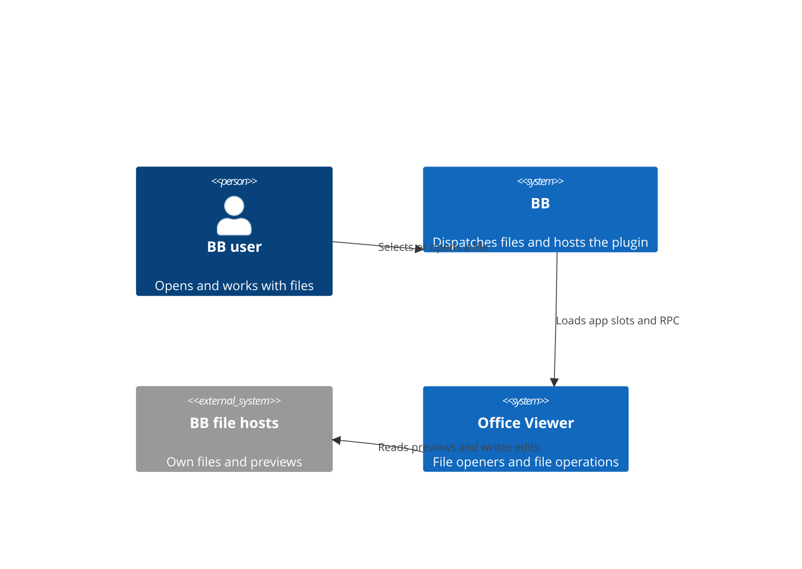
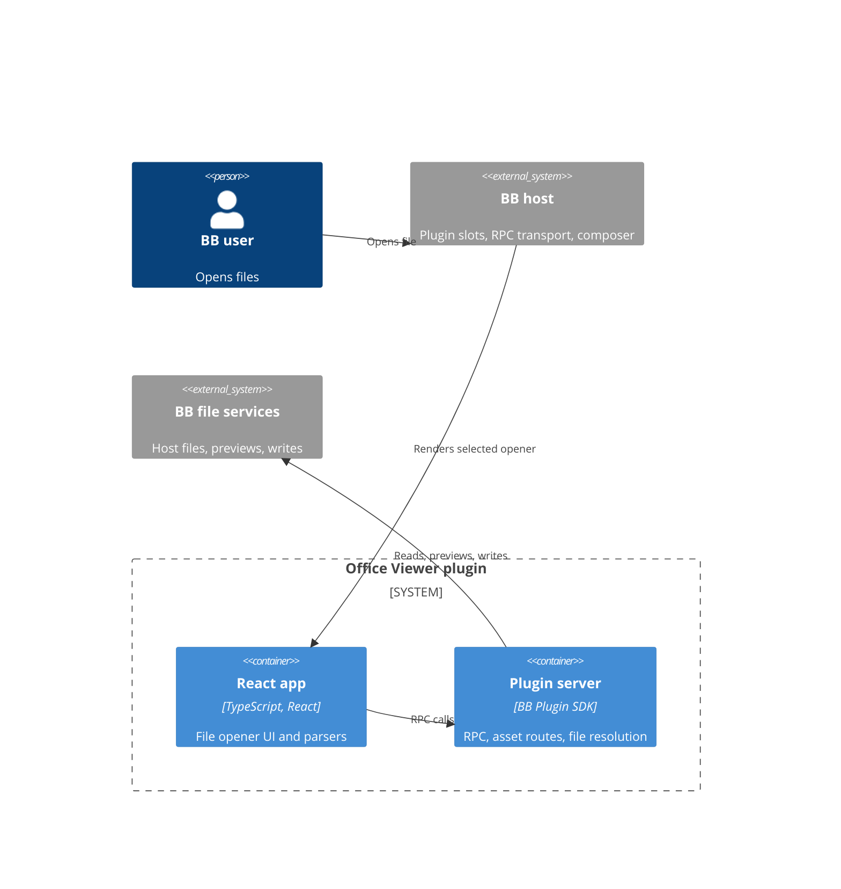
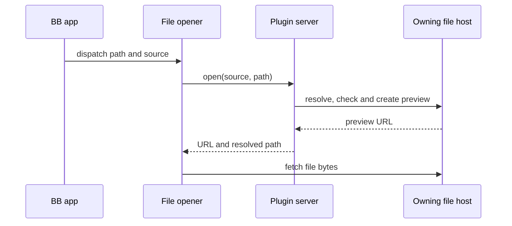
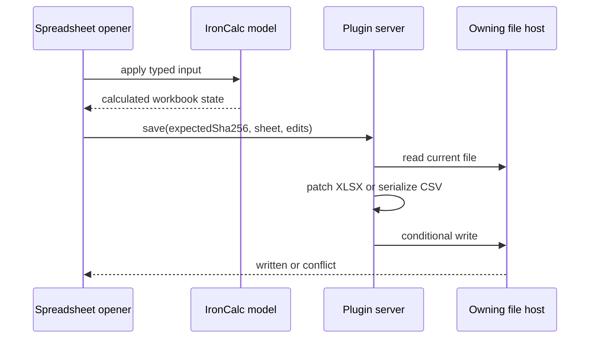

# Office Viewer architecture

TL;DR: BB hosts the React plugin app and plugin server; file openers and thread Studio tools call server RPC for file and thread-storage operations (`app.tsx:19-61`; `server.ts:462-479`).

## System Context

## Containers

The UI registers six file opener slots, two thread-panel actions, a settings section, and experimental thread-header, browser-toolbar, and chat-image-editor slots when those host functions exist (`app.tsx:19-75`). The server registers PDF.js and screenshot assets, prototype schema/icon/preview routes, and a typed RPC contract for file operations and Studio persistence (`server.ts:356-460`; `server.ts:462-570`).

## Building Blocks

- Spreadsheet parsing, engine, grid, formulas and save UI: [Spreadsheet editing](features/spreadsheets.md) (`src/spreadsheet/opener.tsx:103-162`; `src/spreadsheet/engine.ts:55-113`).
- Image, video and audio openers: [Media tools](features/media.md) (`src/media/media.tsx:52-111`).
- Word and PowerPoint viewers: [Office documents](features/office-documents.md) (`src/word/document.tsx:82-141`; `src/slides/slides.tsx:83-149`).
- PDF viewer: [PDF](features/pdf.md) (`src/pdf/pdf.tsx:239-298`).
- Thread tools for wireframe prototypes, slide decks, and paint canvases: [Studio](features/studio.md) (`src/studio/studio-panel.tsx:12-14`; `src/studio/tools.tsx:7-27`).
- Server location policy: `src/server/locate.ts:91-133`; file and Studio RPC handlers: `server.ts:480-933`.

## Key Flows

### Open a supported file

App slot registration passes the opener `path` and `source`, and the server's `open` handler locates the file and requests a preview (`app.tsx:20-25`; `server.ts:505-516`).

### Save spreadsheet edits

Spreadsheet client edits and save behavior are documented in [Spreadsheet editing](features/spreadsheets.md) (`src/spreadsheet/engine.ts:198-239`; `server.ts:548-569`).

## Invariants

- Workspace-relative paths are lexically confined to their resolved root by `within`; host sources require absolute paths (`src/server/locate.ts:49-56`; `src/server/locate.ts:117-133`).
- The file host is selected from the opener's thread, environment, project or explicit host context; location failures are surfaced instead of silently choosing another computer (`src/server/locate.ts:91-133`).
- Spreadsheet save concurrency behavior: [Spreadsheet editing](features/spreadsheets.md) (`server.ts:548-567`).
- Spreadsheet edit schemas cap edits at 50,000 and constrain row/column coordinates to spreadsheet bounds (`server.ts:60-67`; `server.ts:106-118`).

## Cross-cutting concerns

The plugin server registers HTTP asset routes and the RPC contract through the BB Plugin SDK (`server.ts:356-479`). File access is through `bb.sdk.files`, `bb.sdk.hosts`, threads, environments and projects (`src/server/locate.ts:22-36`; `server.ts:480-569`). Selected file read/preview/write errors are converted to path/host-aware messages (`server.ts:344-354`).

<!-- lane-pilot:backlinks -->
## Referenced by

- [Office Viewer overview](overview.md)
