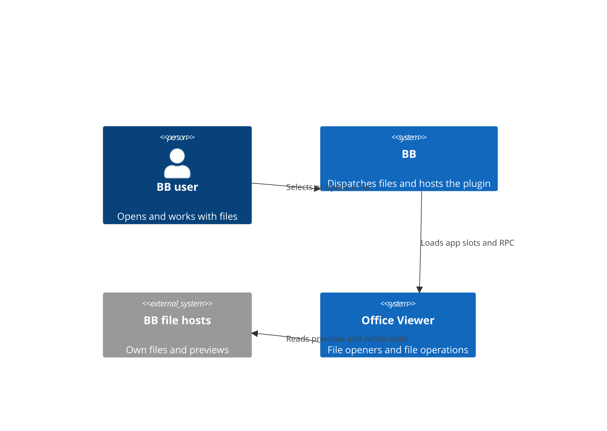
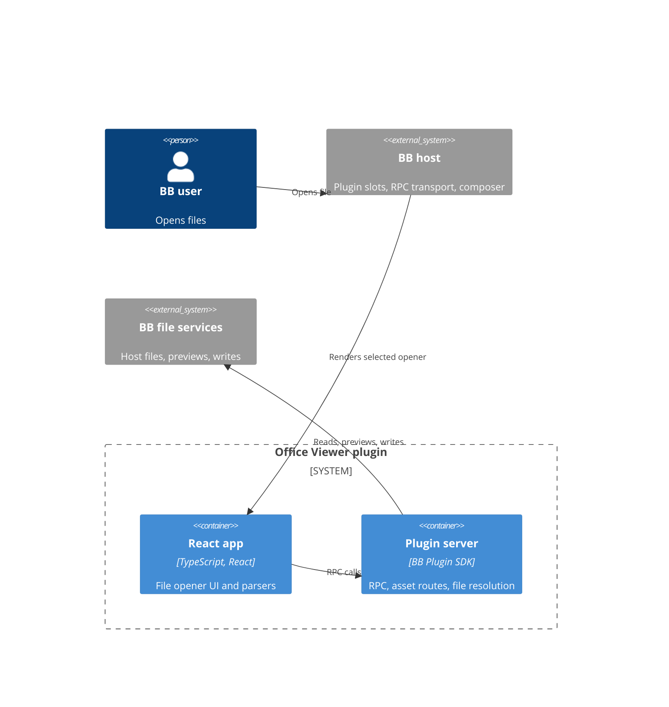
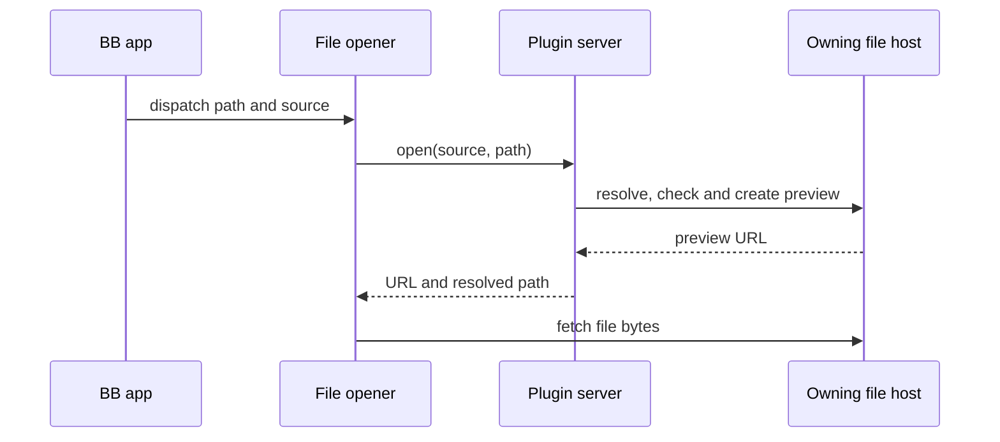
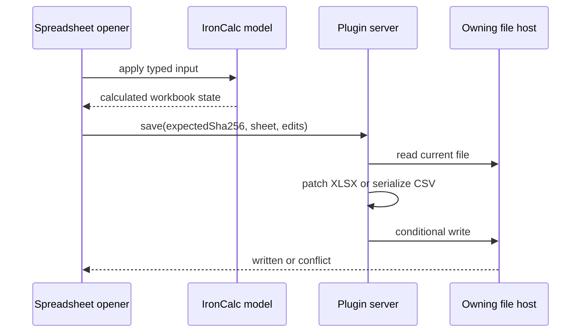

# Office Viewer architecture

TL;DR: BB hosts a React plugin app and a plugin server; registered file openers call server RPC to resolve/read/write files on the machine that owns them (`app.tsx:14-52`; `server.ts:125-126`; `server.ts:154-178`).

## System Context

## Containers

The UI registers five file opener slots and an optional experimental image-editor slot (`app.tsx:14-52`). The server registers GET routes for PDF.js and screenshot assets plus one typed RPC contract (`server.ts:129-153`; `server.ts:154-178`).

## Building Blocks

- Spreadsheet parsing, engine, grid, formulas and save UI: [Spreadsheet editing](features/spreadsheets.md) (`src/spreadsheet/opener.tsx:103-162`; `src/spreadsheet/engine.ts:55-113`).
- Image, video and audio openers: [Media tools](features/media.md) (`src/media/media.tsx:52-111`).
- Word and PowerPoint viewers: [Office documents](features/office-documents.md) (`src/word/document.tsx:82-141`; `src/slides/slides.tsx:83-149`).
- PDF viewer: [PDF](features/pdf.md) (`src/pdf/pdf.tsx:239-298`).
- Server location policy: `src/server/locate.ts:91-133`; RPC handlers: `server.ts:132-234`.

## Key Flows

### Open a supported file

App slot registration passes the opener `path` and `source`, and the server's `open` handler locates the file and requests a preview (`app.tsx:14-44`; `server.ts:167-177`).

### Save spreadsheet edits

The client translates touched cells to edits; server save checks the source hash before patching and passes the expected hash to the file write (`src/spreadsheet/engine.ts:198-239`; `server.ts:210-234`).

## Invariants

- Workspace-relative paths are lexically confined to their resolved root by `within`; host sources require absolute paths (`src/server/locate.ts:49-56`; `src/server/locate.ts:117-133`).
- The file host is selected from the opener's thread, environment, project or explicit host context; location failures are surfaced instead of silently choosing another computer (`src/server/locate.ts:91-133`).
- Spreadsheet saves compare the read file's SHA-256 with `expectedSha256`; a mismatch returns `conflict` without writing (`server.ts:210-218`).
- Spreadsheet edit schemas cap edits at 50,000 and constrain row/column coordinates to spreadsheet bounds (`server.ts:30-37`; `server.ts:66-77`).

## Cross-cutting concerns

Authentication is delegated to BB's plugin RPC and HTTP host; `server.ts` contains no user identity check in the registered handlers (`server.ts:114-132`). File access is through `bb.sdk.files`, `bb.sdk.hosts`, threads, environments and projects (`src/server/locate.ts:22-36`; `server.ts:142-210`). Errors from file reads/previews/writes are converted to path/host-aware messages for missing or unavailable machines (`server.ts:102-112`).

<!-- lane-pilot:backlinks -->
## Referenced by

- [Office Viewer overview](overview.md)
