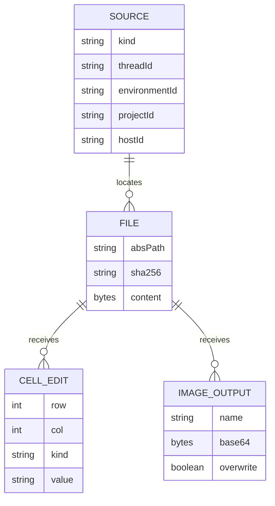

# Office Viewer data model

TL;DR: The plugin has no application database; its durable data is the BB-hosted file being viewed or edited, while parsers and UI keep transient models in memory (`server.ts:142-231`; `src/spreadsheet/engine.ts:22-29`).

## Schema overview

These are conceptual request and file records, not database tables. The source schema and edit shape are defined by RPC validation; storage is provided by BB file APIs (`server.ts:18-37`; `server.ts:59-78`; `src/server/locate.ts:14-20`).

## Stored data

### BB-hosted source files

**Purpose:** Original files opened in the plugin. BB owns persistent bytes; the plugin requests previews or reads bytes via `bb.sdk.files` (`server.ts:142-177`; `server.ts:210-227`).

| Field | Meaning | Key / source |
|---|---|---|
| `kind` | Source resolution mode: `host`, `thread-storage` or `workspace` | Enum supplied in RPC source (`server.ts:18-27`). |
| `threadId` | Thread context for environment or thread storage resolution | BB opener source (`src/server/locate.ts:6-12`; `src/server/locate.ts:91-108`). |
| `environmentId` | Environment whose host and root own the workspace file | BB environment lookup (`src/server/locate.ts:58-68`; `src/server/locate.ts:99-103`). |
| `projectId` | Project used to select a configured source path | BB project lookup (`src/server/locate.ts:103-110`). |
| `hostId` | Host identifier that stores the file | Explicit source or resolved host (`src/server/locate.ts:111-132`). |
| `path` / `absPath` | Caller path and resolved absolute path on `hostId` | Path schema and resolver (`server.ts:28`; `src/server/locate.ts:14-20`; `src/server/locate.ts:91-133`). |
| `sha256` | Version token used to prevent overwriting concurrent file changes | Returned by file read and passed as `expectedSha256` to write (`server.ts:210-231`). |
| `content` | File bytes in UTF-8 or base64, depending on BB file response | Read and decoded by handlers (`server.ts:145-150`; `server.ts:213-218`). |

**Writers and readers:** BB file services own original files. This plugin reads to preview, extract Word text or patch spreadsheet content; it writes spreadsheets in editable formats and edited image outputs (`server.ts:142-231`). There is no plugin-defined retention or cleanup job.

### Spreadsheet edit payload

**Purpose:** Transient list of cell changes submitted to `save`; each item identifies a zero-based row/column and a discriminated value kind (`server.ts:30-37`; `server.ts:66-72`).

| Field | Meaning | Key / allowed values |
|---|---|---|
| `sheet.index` | Position of sheet in workbook | Non-negative integer (`server.ts:68-70`). |
| `sheet.name` | Expected sheet identity paired with index | Required string; patcher checks both (`server.ts:68-70`; `src/spreadsheet/xlsx-patch.ts:258-261`). |
| `row`, `col` | Zero-based cell location | Row 0–1,048,575; column 0–16,383 (`server.ts:30-37`). |
| `kind` | Edit operation | `string`, `number`, `boolean`, `formula`, or `clear` (`server.ts:31-37`). |
| `text`, `value`, `formula`, `format` | Typed cell contents, formula or optional number format | Per-kind validation caps text at 32,767 chars, formula at 8,192, format at 255 (`server.ts:31-37`). |
| `expectedSha256` | Version of the file the UI edited | Compared before read-modify-write and supplied to conditional write (`server.ts:66-78`; `server.ts:213-229`). |

**Lifecycle:** The browser constructs edits for changed cells, the server validates, reads the file, patches bytes and conditionally writes. A changed hash produces `conflict`; no edits are retained as a server-side record (`src/spreadsheet/engine.ts:198-239`; `server.ts:210-231`).

## Invariants

- Workspace and thread-storage paths are constrained to their roots; host paths must be absolute (`src/server/locate.ts:48-56`; `src/server/locate.ts:91-133`).
- XLSX sheet index and name must still identify the same sheet at patch time (`src/spreadsheet/xlsx-patch.ts:258-261`).
- CSV and TSV source formatting details are held in a parsed in-memory representation and used by serialization (`src/spreadsheet/csv.ts:4-19`; `src/spreadsheet/csv.ts:97-131`).
- Media editor canvas, annotation history and PDF/Word viewer state are runtime UI state, not durable plugin records (`src/media/image-editor.tsx:52-68`; `src/media/image-editor.tsx:433-442`).

## Lifecycle, retention and cleanup

The source file remains in BB storage after viewing. Object URLs for media blobs are revoked on replacement/unmount; spreadsheet engine models and parsed documents live with their viewer; the server caches the IronCalc WASM base64 promise in process memory and clears it after a failed load (`src/media/media.tsx:131-135`; `src/spreadsheet/opener.tsx:103-162`; `server.ts:132-140`). This repository defines no database migrations, retention period or background cleanup job.

<!-- lane-pilot:backlinks -->
## Referenced by

- [Office Viewer overview](overview.md)
