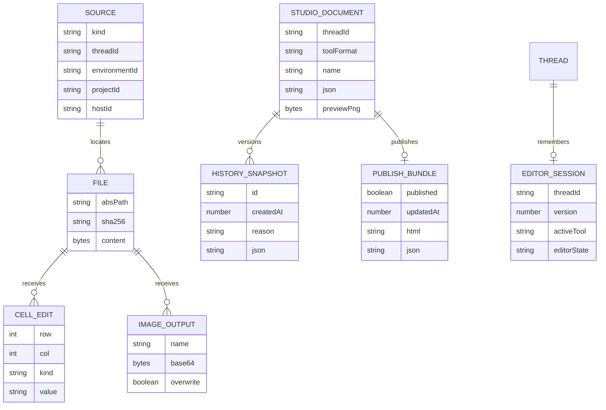

# Office Viewer data model

TL;DR: The plugin has no application database; durable state lives in BB-hosted source files and thread-scoped Studio documents, while parsers and editor state are held in browser memory or local storage (`server.ts:480-569`; `server.ts:571-611`; `src/studio/session.ts:7-38`).

## Schema overview

These are conceptual request and file records, not database tables. The source schema and edit shape are defined by RPC validation; storage is provided by BB file APIs. Studio documents, snapshots and publish bundles are files in thread storage, and editor session state is stored per thread in browser local storage (`server.ts:48-67`; `src/server/locate.ts:14-20`; `src/server/wireframe-history.ts:31-40`; `src/server/wireframe-publish.ts:17-30`; `src/studio/session.ts:7-38`).

The tool workflows and editor behavior are described in [Studio tools](features/studio.md).

## Stored data

### BB-hosted source files

**Purpose:** Original files opened in the plugin. BB owns persistent bytes; the plugin requests previews or reads bytes via `bb.sdk.files` (`server.ts:480-516`; `server.ts:548-569`).

| Field | Meaning | Key / source |
|---|---|---|
| `kind` | Source resolution mode: `host`, `thread-storage` or `workspace` | Enum supplied in RPC source (`server.ts:18-27`). |
| `threadId` | Thread context for environment or thread storage resolution | BB opener source (`src/server/locate.ts:6-12`; `src/server/locate.ts:91-108`). |
| `environmentId` | Environment whose host and root own the workspace file | BB environment lookup (`src/server/locate.ts:58-68`; `src/server/locate.ts:99-103`). |
| `projectId` | Project used to select a configured source path | BB project lookup (`src/server/locate.ts:103-110`). |
| `hostId` | Host identifier that stores the file | Explicit source or resolved host (`src/server/locate.ts:111-132`). |
| `path` / `absPath` | Caller path and resolved absolute path on `hostId` | Path schema and resolver (`server.ts:28`; `src/server/locate.ts:14-20`; `src/server/locate.ts:91-133`). |
| `sha256` | Version token used to prevent overwriting concurrent file changes | Returned by file read and passed as `expectedSha256` to write (`server.ts:548-569`). |
| `content` | File bytes in UTF-8 or base64, depending on BB file response | Read and decoded by handlers (`server.ts:483-488`; `server.ts:551-556`). |

**Writers and readers:** BB file services own original files. This plugin reads to preview, extract Word text or patch spreadsheet content; it writes spreadsheets in editable formats and edited image outputs (`server.ts:480-569`; `server.ts:527-547`). There is no plugin-defined retention or cleanup job.

### Spreadsheet edit payload

**Purpose:** Transient list of cell changes submitted to `save`; each item identifies a zero-based row/column and a discriminated value kind (`server.ts:60-67`; `server.ts:106-118`).

| Field | Meaning | Key / allowed values |
|---|---|---|
| `sheet.index` | Position of sheet in workbook | Non-negative integer (`server.ts:110-112`). |
| `sheet.name` | Expected sheet identity paired with index | Required string; patcher checks both (`server.ts:110-112`; `src/spreadsheet/xlsx-patch.ts:258-261`). |
| `row`, `col` | Zero-based cell location | Row 0–1,048,575; column 0–16,383 (`server.ts:60-67`). |
| `kind` | Edit operation | `string`, `number`, `boolean`, `formula`, or `clear` (`server.ts:61-67`). |
| `text`, `value`, `formula`, `format` | Typed cell contents, formula or optional number format | Per-kind validation caps text at 32,767 chars, formula at 8,192, format at 255 (`server.ts:61-67`). |
| `expectedSha256` | Version of the file the UI edited | Compared with the current file read and supplied to conditional write (`server.ts:106-118`; `server.ts:548-569`). |

**Lifecycle:** The browser constructs edits for changed cells, the server validates, reads the file, patches bytes and conditionally writes. A changed hash produces `conflict`; no edits are retained as a server-side record (`src/spreadsheet/engine.ts:198-239`; `server.ts:548-569`).

### Thread-scoped Studio documents

**Purpose:** Durable editable documents for the prototype, slides and paint tools. Prototype JSON and PNG files use `Prototypes/`, slide JSON and PNG use `Slides/`, and paint JSON and PNG use `Paint/` under the thread storage root (`src/server/wireframes.ts:4-5`; `src/server/slides.ts:3-5`; `src/server/paint.ts:3-5`; `server.ts:571-611`; `server.ts:840-860`; `server.ts:885-908`).

| Field | Meaning | Key / allowed values |
|---|---|---|
| `threadId` | BB thread whose storage owns the document | Required RPC identifier, max 256 characters (`server.ts:120-128`; `server.ts:300-309`). |
| `toolFormat` | Document parser discriminator | Wireframe schema for prototype; `bb-slides` version 1; `bb-paint` version 1 (`src/studio/prototype/model.ts:1-20`; `src/studio/slides/model.ts:13-16`; `src/studio/paint/paint-model.ts:5-6`). |
| `name` | Sanitized document stem used for paired JSON/PNG paths | Each tool strips recognized suffixes and rejects path separators, leading dot and `..`; maximum stem length is 200 characters (`src/server/wireframes.ts:10-20`; `src/server/slides.ts:9-18`; `src/server/paint.ts:9-19`). |
| `json` | Parsed editable document bytes | Wireframe save input max 8 MiB; slides and paint parsing validate tool-specific shape (`server.ts:120-131`; `src/studio/slides/model.ts:42-80`; `src/studio/paint/paint-model.ts:65-79`). |
| `previewPng` | Optional generated image paired with editable JSON | Base64 input max 60 MiB for prototype, slides and paint save routes (`server.ts:125-127`; `server.ts:300-308`; `server.ts:278-286`). |

**Lifecycle:** Studio lists files for a thread, loads and parses a JSON document, edits it in the browser, then writes JSON and optional PNG. With `overwrite: false`, the requested stem or a `-2` through `-99` free name is selected (`src/studio/prototype/builder.tsx:1264-1303`; `src/studio/slides/editor.tsx:96-125`; `src/studio/paint/paint.tsx:98-118`; `src/server/slides.ts:39-44`; `src/server/paint.ts:40-45`). Validation or file errors reject the RPC; the plugin stores no database row (`server.ts:571-611`; `server.ts:831-884`; `server.ts:885-933`).

**Writers and readers:** Studio editors write documents and previews through save RPCs; list/load RPCs read them back. Published preview routes read a separate HTML/JSON bundle. BB owns thread-storage bytes; this repository defines no Studio file cleanup job or retention period (`src/studio/prototype/builder.tsx:1264-1303`; `src/studio/slides/editor.tsx:76-125`; `src/studio/paint/paint.tsx:98-123`; `server.ts:418-460`; `server.ts:718-765`).

### Prototype history and published preview

**Purpose:** Prototype history stores bounded JSON snapshots. Publishing stores an index, generated player HTML and prototype JSON beneath `.publish/<stem>/` in the thread's Prototypes area (`src/server/wireframe-history.ts:4-13`; `src/server/wireframe-publish.ts:4-30`).

| Field | Meaning | Key / allowed values |
|---|---|---|
| `id` | Snapshot identifier and timestamp string | Generated from `Date.now()` (`src/server/wireframe-history.ts:43-45`). |
| `createdAt` | Snapshot creation time in milliseconds | Numeric timestamp; index entries sort newest first (`src/server/wireframe-history.ts:10-14`; `src/server/wireframe-history.ts:47-49`). |
| `reason` | Why a snapshot was captured | `save`, `autosave` or `risky` (`src/server/wireframe-history.ts:7-8`). |
| `published` | Whether HTTP preview routes serve this prototype | Boolean in publish index; unpublish writes false (`src/server/wireframe-publish.ts:6-13`; `server.ts:742-752`). |
| `updatedAt` | Publish update time in milliseconds | Set when publishing or unpublishing (`server.ts:725-740`; `server.ts:742-752`). |

| From | To | Function | When |
|---|---|---|---|
| absent or false | true | `publishWireframePreview` (`server.ts:718-740`) | Publish writes the index and preview bundle. |
| true or absent | false | `unpublishWireframePreview` (`server.ts:742-752`) | Unpublish writes a false index flag; bundle files remain. |

**Lifecycle:** Save, autosave or risky events append a JSON snapshot and update the index; entries are pruned to the newest 50. Loading history returns validated JSON marked read-only; restore writes selected snapshot content back as the current prototype. Publishing writes index, player HTML and JSON; unpublishing changes the index flag while leaving bundle files in place (`src/server/wireframe-history.ts:47-57`; `src/server/wireframe-history-store.ts:41-57`; `server.ts:773-810`; `server.ts:718-752`).

**Writers and readers:** `saveWireframe` writes snapshots when requested; history list/load/restore RPC methods read or restore them; preview HTTP routes read the publish index and bundle. No job deletes pruned snapshot files or unpublished bundles in this repository (`server.ts:571-611`; `server.ts:766-810`; `server.ts:418-460`; `server.ts:718-765`).

### Browser editor session

**Purpose:** Browser local storage stores the active Studio tool and enough validated editor state to restore the current thread's prototype, slide deck or paint editor (`src/studio/session.ts:7-38`; `src/studio/session.ts:109-129`).

| Field | Meaning | Key / allowed values |
|---|---|---|
| `v` | Session format version | Only version 1 parses (`src/studio/session.ts:32-38`; `src/studio/session.ts:61-66`). |
| `tool` | Selected Studio tool | `prototype`, `slides`, `paint` or `null` (`src/studio/session.ts:32-38`; `src/studio/session.ts:61-66`). |
| `prototype`, `slides`, `paint` | Tool document and view state | Each is parsed with its document parser; selection IDs are strings capped at 400; zoom is clamped to 0.05–8 (`src/studio/session.ts:51-59`; `src/studio/session.ts:67-105`). |

| From | To | Function | When |
|---|---|---|---|
| null or any tool | prototype, slides, paint or null | `pick` (`src/studio/studio-panel.tsx:39-42`) | User selects a tool or returns to the tool list. |

**Lifecycle:** Editors update the per-thread local-storage key and reload it on mount. Invalid JSON or session versions fall back to an empty session; invalid tool documents are dropped. The browser owns this data and the repository defines no expiry or cleanup (`src/studio/session.ts:61-129`; `src/studio/session.ts:109-114`).

## Invariants

- Workspace and thread-storage paths are constrained to their roots; host paths must be absolute (`src/server/locate.ts:48-56`; `src/server/locate.ts:91-133`).
- XLSX sheet index and name must still identify the same sheet at patch time (`src/spreadsheet/xlsx-patch.ts:258-261`).
- CSV and TSV source formatting details are held in a parsed in-memory representation and used by serialization (`src/spreadsheet/csv.ts:4-19`; `src/spreadsheet/csv.ts:97-131`).
- Media editor canvas, annotation history and PDF/Word viewer state are runtime UI state, not durable plugin records (`src/media/image-editor.tsx:52-68`; `src/media/image-editor.tsx:433-442`).
- Studio copies in browser local storage are restoration state; BB thread-storage files remain the durable saved documents (`src/studio/session.ts:109-129`; `server.ts:571-611`).

## Lifecycle, retention and cleanup

The source file remains in BB storage after viewing. Object URLs for media blobs are revoked on replacement/unmount; spreadsheet engine models and parsed documents live with their viewer; the server caches the IronCalc WASM base64 promise in process memory and clears it after a failed load (`src/media/media.tsx:131-135`; `src/spreadsheet/opener.tsx:103-162`; `server.ts:471-478`). Wireframe history indexes keep at most 50 entries, but the code does not delete pruned snapshot files; this repository defines no database migrations, general retention period or background cleanup job (`src/server/wireframe-history.ts:47-57`; `src/server/wireframe-history-store.ts:41-57`).

<!-- lane-pilot:backlinks -->
## Referenced by

- [Office Viewer overview](overview.md)
